# Entende+

**Adaptação de material didático para estudantes com TEA do 5º ano.**

O professor envia o material que já usa em sala, em PDF ou DOCX. O Entende+ devolve uma versão
adaptada para estudantes com Transtorno do Espectro Autista, segundo um conjunto de regras
publicado e versionado. A partir do mesmo material, gera uma atividade que a criança faz pelo
link, como jogo, lista de perguntas ou folha impressa. Nada é publicado sem a revisão e a
aprovação do professor.

Trabalho de Conclusão de Curso em Sistemas de Informação — CEUNI FAMETRO, 2026.

**Acesse:** <https://emmanuelgbl.github.io/Plataforma_Entende-/>

---

## Sumário

- [Por que existe](#por-que-existe)
- [Telas](#telas)
- [Funcionalidades principais](#funcionalidades-principais)
- [Como a adaptação funciona](#como-a-adaptação-funciona)
- [A atividade, em três formas](#a-atividade-em-três-formas)
- [Tecnologias utilizadas](#tecnologias-utilizadas)
- [Estrutura do projeto](#estrutura-do-projeto)
- [Pré-requisitos e como rodar](#pré-requisitos-e-como-rodar)
- [Implantação](#implantação)
- [Acessibilidade](#acessibilidade)
- [Privacidade](#privacidade)
- [Autores e orientação](#autores-e-orientação)

## Por que existe

Adaptar um texto didático para um estudante com TEA (períodos mais curtos, linguagem literal,
vocabulário explicado, estrutura anunciada antes do conteúdo) é trabalho manual, repetido a cada
material, e recai sobre o professor da sala comum e o do Atendimento Educacional Especializado.
O Entende+ automatiza a parte mecânica dessa adaptação e deixa a decisão com o professor.

O recorte é deliberado: **um perfil (TEA), uma etapa (5º ano do ensino fundamental) e um campo
(rede municipal de Manaus)**. Um único conjunto de regras, derivado da literatura sobre
compreensão leitora no autismo e aplicado a textos de complexidade parecida, permite avaliar o
resultado com critério. Outros perfis ficam como trabalho futuro.

Objetivo de Desenvolvimento Sustentável: **ODS 4 — Educação de Qualidade**.

## Telas

As capturas são do modo demonstração, com dados fictícios: a professora "Ana" e os textos de
exemplo foram escritos pela dupla.

| | |
| --- | --- |
| 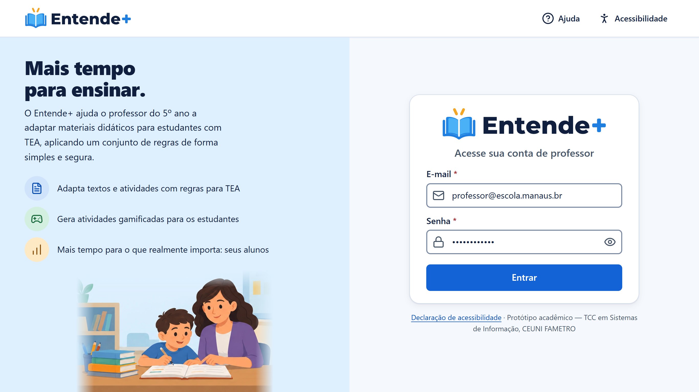 **Entrada.** Acesso do professor. | 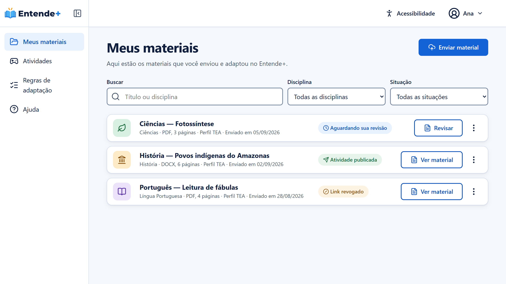 **Meus materiais.** Os materiais enviados e a situação de cada um. |
| 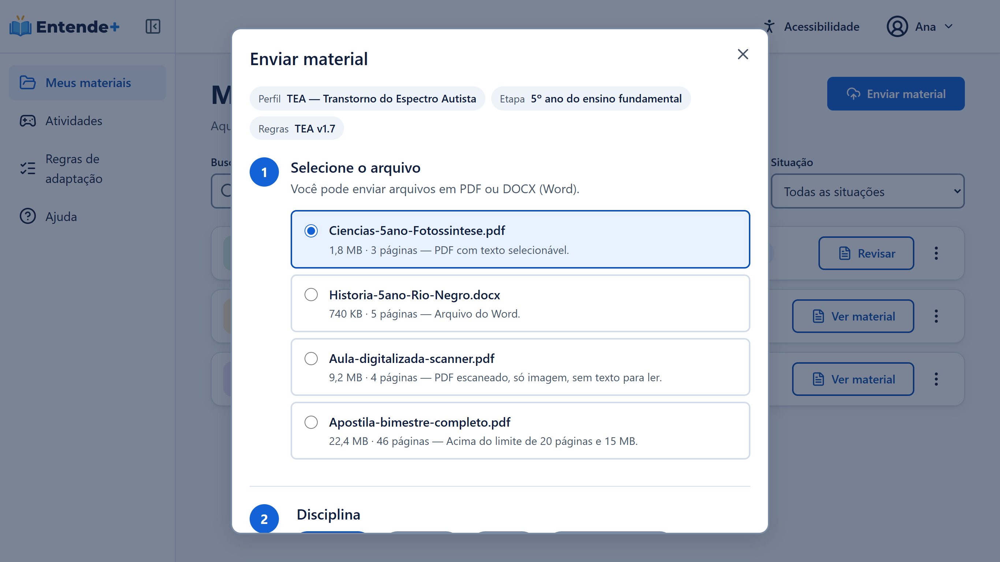 **Enviar material.** PDF ou DOCX, até 20 páginas e 15 MB. | 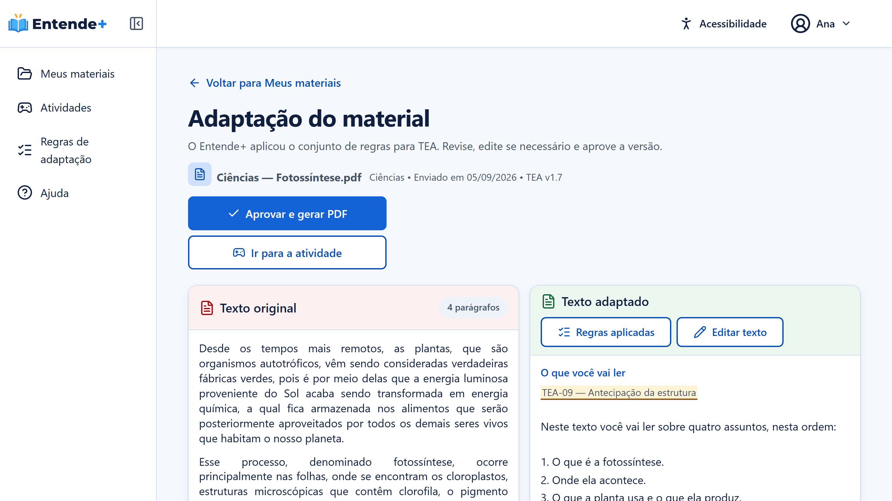 **Adaptação.** Original e adaptado lado a lado, com a regra aplicada em cada trecho. |
| 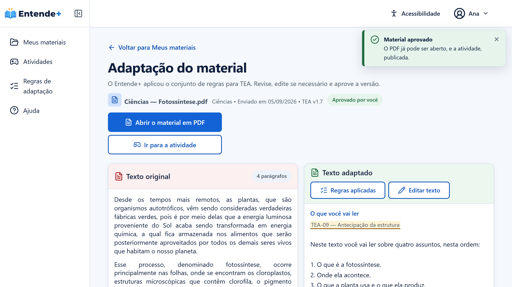 **Aprovação.** Só o material aprovado vira PDF e atividade. | 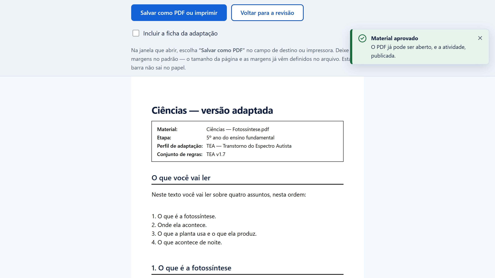 **PDF do material.** Folha formatada para impressão, com a ficha da adaptação opcional. |
| 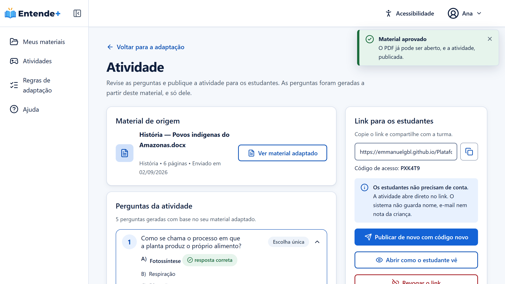 **Atividade.** Revisão das perguntas, link e código para a turma. | 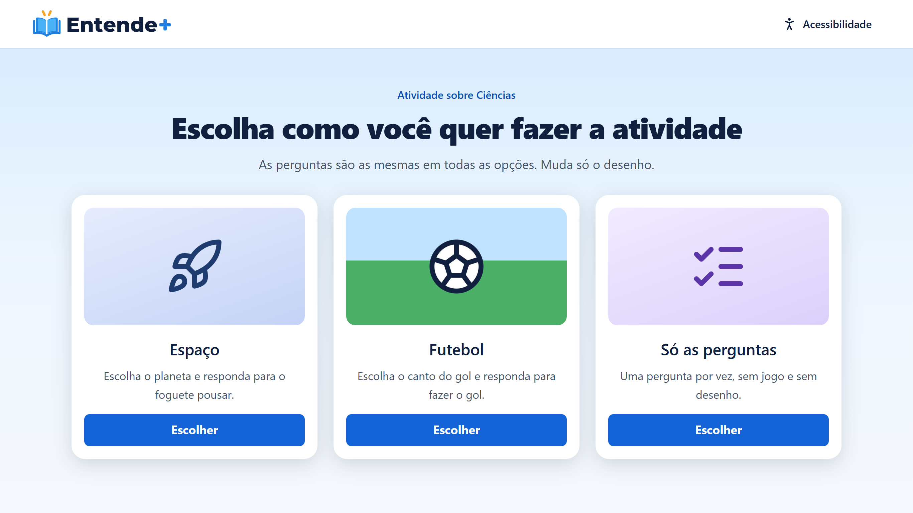 **Escolha.** A criança decide como fazer a atividade. |
| 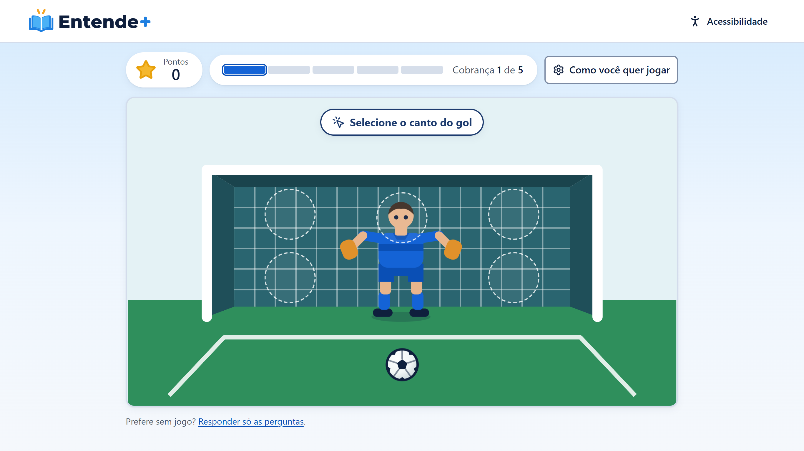 **Jogo.** A criança escolhe o alvo na cena. | 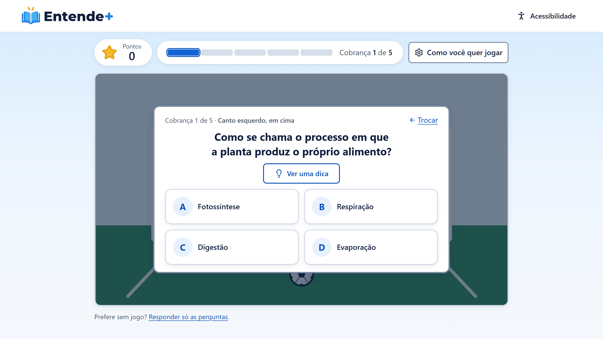 **Pergunta no jogo.** A dica fica disponível antes de responder. |
| 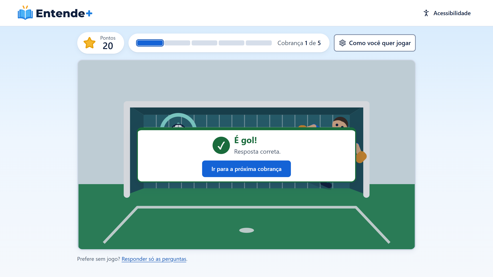 **Acerto.** Reconhecimento visual do acerto. | 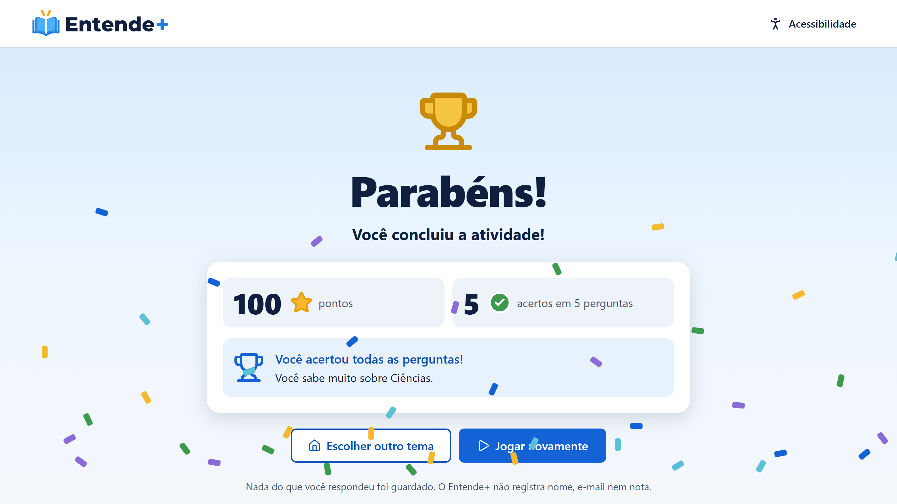 **Conclusão.** Pontos e acertos, com o aviso de que nada foi guardado. |
| 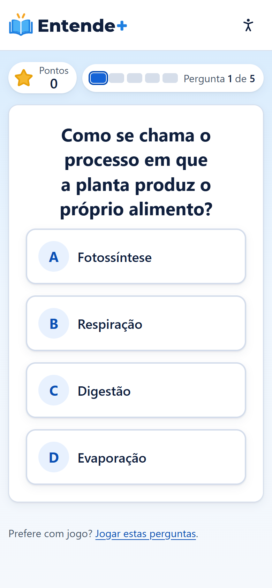 **No celular.** A lista de perguntas em tela estreita. | |

## Funcionalidades principais

**Para o professor**

- Entrar com a conta criada pela administração; não há cadastro aberto. A senha é guardada com hash
  Argon2, e cinco tentativas erradas seguidas
  bloqueiam a entrada por até 15 minutos.
- Enviar material em PDF ou DOCX; o texto é extraído no servidor.
- Receber a versão adaptada, com o registro de quais regras foram aplicadas em cada trecho.
- Comparar original e adaptado lado a lado, editar o texto adaptado e aprovar.
- Ver métricas de legibilidade do antes e do depois (índice de Flesch adaptado ao português).
- Exportar o material aprovado em PDF, com texto selecionável.
- Revisar as perguntas geradas a partir do material e publicar a atividade com link e código;
  revogar o link ou publicar de novo com código novo.
- Imprimir a folha de questões, com gabarito opcional em página separada.
- Ver no topo da tela quantos créditos de adaptação restam; sem créditos, só o que chama
  o modelo de linguagem para de funcionar.

**Para o administrador**

- Criar, editar, desativar e excluir contas de professor, redefinir senha e definir os créditos de cada uma.
  Não vê o conteúdo dos materiais.

**Para o estudante**

- Abrir a atividade pelo link, **sem conta**.
- Escolher entre jogo e lista de perguntas.
- Ajustar tamanho do texto, espaçamento, contraste e movimento no painel de acessibilidade.

## Como a adaptação funciona

O motor é **híbrido**: o código decide o que cada parágrafo precisa, e o modelo de linguagem só
reescreve o que o código marcou, com as instruções das regras que dispararam naquele trecho.
O sistema nunca pede ao modelo que "adapte o texto" livremente.

As regras estão no arquivo [`servidor/regras/tea.json`](servidor/regras/tea.json), que é
versionado: toda adaptação registra a versão das regras e o modelo usados, e mudar uma regra
exige mudar a versão. Versão atual: **TEA v1.8**, com onze regras.

| Regra | Quem aplica |
| --- | --- |
| TEA-01 Períodos curtos | modelo, quando o código detecta período com mais de 20 palavras |
| TEA-02 Uma ideia por bloco | modelo, quando o parágrafo tem mais de 3 frases |
| TEA-03 Linguagem literal | modelo, quando há expressão figurada da lista |
| TEA-04 Voz ativa e ordem direta | modelo, quando há voz passiva |
| TEA-05 Vocabulário explicado | código, pelo glossário do arquivo de regras |
| TEA-06 Conectivos explícitos | modelo, junto com TEA-01 e TEA-02 |
| TEA-07 Subtítulos a cada bloco | modelo, quando passa de 120 palavras sem título |
| TEA-08 Apresentação visual do texto | folha impressa |
| TEA-09 Antecipação da estrutura | código, com a lista dos títulos do texto adaptado |
| TEA-10 Remoção de ruído visual | folha impressa |
| TEA-11 Palavras comuns | modelo, quando o parágrafo tem mais de três palavras diferentes de quatro sílabas ou mais |

O modelo de linguagem é o **GPT-6.1 Sol**, pela API da OpenAI, com saída em esquema JSON fixo.
O Claude, da Anthropic, continua disponível como alternativa configurável. Os limites e o que
acontece quando um pedido falha estão no [`servidor/README.md`](servidor/README.md).

## A atividade, em três formas

A mesma atividade, com as mesmas questões, por três caminhos. Ao abrir o link, a criança escolhe
entre os dois primeiros; o terceiro é do professor.

| Forma | O que é |
| --- | --- |
| **Jogo** | Viagem pelo espaço (o tema neutro, padrão) ou treino de pênalti. A criança toca numa das cinco áreas da cena, responde numa janela dentro do jogo e vê o resultado. |
| **Lista de perguntas** | Uma questão por vez, sem cena e sem desenho. |
| **Folha impressa** | PDF das questões, com gabarito opcional em página separada. |

O desenho do jogo segue catorze regras derivadas de diretrizes publicadas para o perfil TEA. As
que mais o definem:

- **Estrutura de turno sempre igual**, e nenhum cronômetro ou elemento que comunique urgência.
- **Erro gera dica e nova tentativa, nunca perda.** A contagem registra acerto e não registra erro.
- **A dica está disponível antes de responder**, de graça e sem ser contabilizada.
- **Tema é preferência, com opção neutra como padrão**; futebol é escolha, não imposição.
- **Estilo plano, não fotorrealista**, e paleta de tom frio com um único acento quente fora do
  centro visual.

O que se afirma com isso é sobre o **desenho**, não sobre o **efeito**: não há base na literatura
para dizer que a mecânica melhora a aprendizagem de criança autista, e o trabalho não diz.

## Tecnologias utilizadas

| Camada | Tecnologia |
| --- | --- |
| Interface | React 19, Vite 7, React Router 7, Lucide (ícones); CSS escrito à mão |
| Servidor | Python 3.11, FastAPI, Uvicorn, SQLAlchemy 2, Pydantic |
| Banco de dados | SQLite em desenvolvimento; PostgreSQL suportado |
| Segurança | Argon2 (senha), JWT (sessão), HTTPS com certificado Let's Encrypt |
| Leitura de arquivos | pdfplumber (PDF), python-docx (DOCX) |
| Modelo de linguagem | GPT-6.1 Sol (OpenAI); Claude (Anthropic) como alternativa |
| Testes | pytest, com clientes falsos do modelo, para os testes não chamarem a API paga |
| Publicação | GitHub Actions e GitHub Pages (interface); VPS Ubuntu com nginx e systemd (servidor) |

## Estrutura do projeto

```
.
├── src/                  Interface (React)
│   ├── paginas/          As telas
│   ├── componentes/      Componentes reutilizáveis
│   ├── contextos/        Sessão, preferências e todas as operações (Aplicacao.jsx)
│   ├── servicos/         Cliente do servidor e modo demonstração
│   ├── dados/            Conteúdo fixo do modo demonstração
│   └── estilos/          Tokens, base, componentes, jogo e impressão
├── public/               Marca e ilustrações
├── servidor/             API (FastAPI)
│   ├── app/              Rotas, serviços, modelos e motor de adaptação
│   ├── regras/tea.json   Conjunto de regras versionado
│   └── testes/           Testes automatizados (pytest)
├── implantar/            Instalação na VPS (nginx, systemd, scripts)
├── docs/telas/           Capturas usadas neste README
└── .github/workflows/    Publicação no GitHub Pages
```

O [`LEIA-ME.md`](LEIA-ME.md) detalha a interface: onde está cada coisa, as rotas com os casos de
uso correspondentes e as decisões técnicas que quebram o sistema se forem alteradas sem contexto.

## Pré-requisitos e como rodar

- **Node.js 20 ou mais recente** (a publicação usa o 22).
- **Python 3.11 ou mais recente**, para o servidor.
- Uma chave da API da OpenAI, só para adaptar material de verdade. Sem ela, conta, envio e
  extração funcionam, e a adaptação responde explicando o que falta.

### A interface sozinha (modo demonstração)

```
npm install
npm run dev       # http://localhost:5173
```

Sem `VITE_API_URL`, a interface roda em memória, com dados fixos de `src/dados/conteudo.js`:
qualquer senha entra e há quatro materiais de exemplo. A exportação em PDF e o jogo funcionam de
verdade.

```
npm run build     # gera dist/ — para servidor HTTP
npm run offline   # gera "Entende+ (protótipo).html" — arquivo único, abre por duplo clique
```

### A interface com o servidor

As instruções completas estão em [`servidor/README.md`](servidor/README.md). Em resumo, no
PowerShell:

```
cd servidor
python -m venv .venv
.venv\Scripts\python -m pip install -r requirements-dev.txt
copy .env.exemplo .env          # preencha ENTENDE_SEGREDO_TOKEN e OPENAI_API_KEY
.venv\Scripts\python -m uvicorn app.principal:app --no-access-log
```

E, na raiz, com o servidor rodando:

```
$env:VITE_API_URL = "http://localhost:8000"; npm run dev
```

`--no-access-log` não é opcional: o log de acesso padrão gravaria o IP de quem abre a atividade
da criança.

## Implantação

- **Interface:** publicada no GitHub Pages pelo workflow
  [`.github/workflows/publicar.yml`](.github/workflows/publicar.yml) a cada envio para a `main`.
- **Servidor:** VPS Ubuntu 22.04, instalada por [`implantar/instalar.sh`](implantar/instalar.sh).
  O nginx serve a API com HTTPS, num site à parte e sem log, e o certbot renova o certificado. O
  servidor roda como serviço do systemd e só escuta em `127.0.0.1`. A chave da API fica no `.env`
  da VPS, que nunca entra neste repositório.

O Pages é construído com `VITE_API_URL` e abre ligado ao servidor: para entrar, é preciso uma conta
criada pela administração. A demonstração, que não pede conta, continua disponível na tela de
entrada, em "Abrir a demonstração".

## Acessibilidade

Alvo: **WCAG 2.2 nível AA** e **e-MAG 3.1**. Três critérios AAA foram adotados por serem o
objeto do trabalho.

Auditoria executada em 11/09/2026 com axe-core 4.10.2 nas dez rotas então existentes, mais
medição de reflow em viewport de 320 px e percurso por teclado. **Quatro violações encontradas,
todas corrigidas; as dez rotas fecham com zero violação.**

Pendentes e declarados: validação pelo ASES; leitura com NVDA; e repetir a auditoria automática
nas três rotas acrescentadas em 20/09 (escolha da forma, jogo e folha de questões). Na cena do
jogo, o SVG é `aria-hidden`, e tudo que acontece nele é dito em texto e anunciado na região de
status. Isso é decisão de projeto e ainda não foi medido.

Todas as telas têm o painel de preferências de exibição (tamanho do texto, espaçamento, alto
contraste e redução de movimento), e as escolhas ficam gravadas entre sessões.

## Privacidade

O estudante não tem conta. O sistema não guarda nome, e-mail, nota nem IP de quem abre a
atividade. O material enviado pelo professor é tratado como dado, nunca como instrução ao modelo
de linguagem.

## Autores e orientação

| | |
| --- | --- |
| **Emmanuel Gabriel Martins Monteiro** | Autor — [@EmmanuelGBL](https://github.com/EmmanuelGBL) |
| **Hugo Macedo Lima** | Autor |
| **Profa. Msc. Luana Leal** | Orientadora |

Curso de Sistemas de Informação — CEUNI FAMETRO, Manaus, 2026.

## Licença e uso

Trabalho acadêmico. O código está aberto para consulta e avaliação; o nome **Entende+** e a
identidade visual são do projeto.
